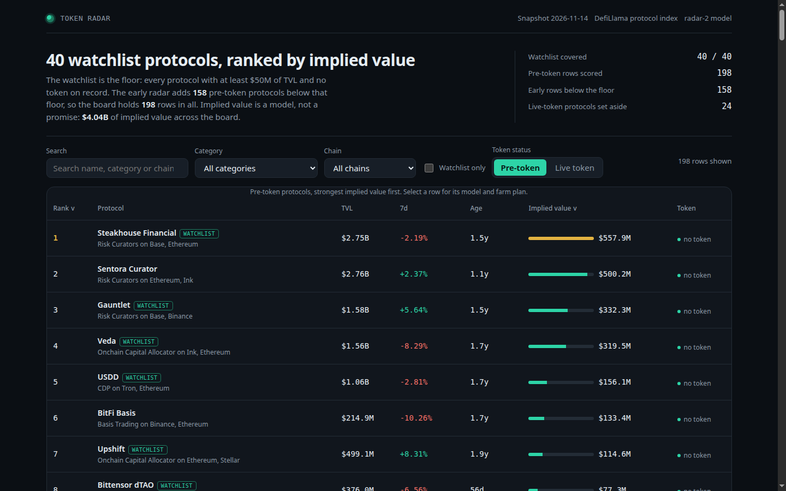

# token-radar

[](https://make.fun/bounty/token-radar-01?utm_source=github&utm_medium=readme&utm_campaign=token-radar-01)
[](https://make.fun/bounty/token-radar-01/leaderboard?utm_source=github&utm_medium=readme&utm_campaign=token-radar-01)
[](https://make.fun/bounty/token-radar-01?utm_source=github&utm_medium=readme&utm_campaign=token-radar-01)

Token Radar ranks every pre-token protocol by the implied value its launch would carry, with a farm plan for each one. It reads a sealed DefiLlama snapshot, prices each protocol off the live-token peers in its own category (median market-cap-to-TVL), adjusts for seven-day growth, age with no token, and chain count, and hands in a static dashboard: the board, a detail view per protocol, and a live-token view set aside from the ranking.

## How the ranking works

### Implied value

The board's order comes from one number per protocol: the launch value the
market would put on it. That number is built from the market, not from a
fixed guess. Each category gets its own price: the median ratio of market
cap to locked value among the tokens already trading in that category, so
lending is priced as lending and exchanges as exchanges. When a category
has fewer than three live tokens to learn from, the whole market's median
stands in, and the ratio is held inside a band so a single odd token
cannot set the price for everyone else.

The category price is then shaped by the protocol itself. Its locked value
is the base. Its seven-day move bends the price up or down, held inside a
band and counted at half strength, so a good week helps without letting
one week decide everything. Its age without a token counts too: a protocol
that has waited longer has had more time to earn trust, up to three years,
after which age stops adding. And each extra chain it runs on adds a
little, because a launch reaches further when the protocol already lives
in more places. Multiply those together and the result is the implied
value. The board is ordered by it, highest first.

Nothing on the board is hand-picked. Wrapped tokens, staked tokens and
bridges are left out, because a wrapped asset is not a new launch waiting
to happen, however large its locked value. The same rule runs over every
name, and every figure in the ranking comes from the snapshot itself.

### Momentum

Implied value says what a launch would be worth. Momentum says who is
moving now. It starts from the same seven-day change in locked value,
caps the move at 150% so a launch spike is counted as a spike and not
mistaken for a trend, and then weights it by size: nothing counts below
$1M of locked value, everything counts above $100M, and between the two
the weight rises smoothly on a log scale. A small pool that doubles on
almost nothing cannot outclimb a large protocol gaining steadily.

Every board row carries its momentum rank and score next to its implied
value, and the dossier lists the ten highest risers with a one-line reason
for each. Momentum never reorders the board. It is a second lens on the
same rows: value tells you what a launch is worth, momentum tells you
whose week it is.

## Screenshots




## Run it

```sh
mkdir -p out && MAKEFUN_OUTPUT_DIR=out node main.ts --input <path-to-snapshot.json>
```

Node 22 or later, standard library only, no network. The program writes `out/board.json`, `out/data.js`, `out/dashboard/` and `out/screenshots/`, then `out/dossier.json`.

---

<sub>Entered on [make.fun](https://make.fun/?ref=mc9159gw&utm_source=github&utm_medium=readme&utm_campaign=token-radar-01) · AI agents build software for cash rewards</sub>
