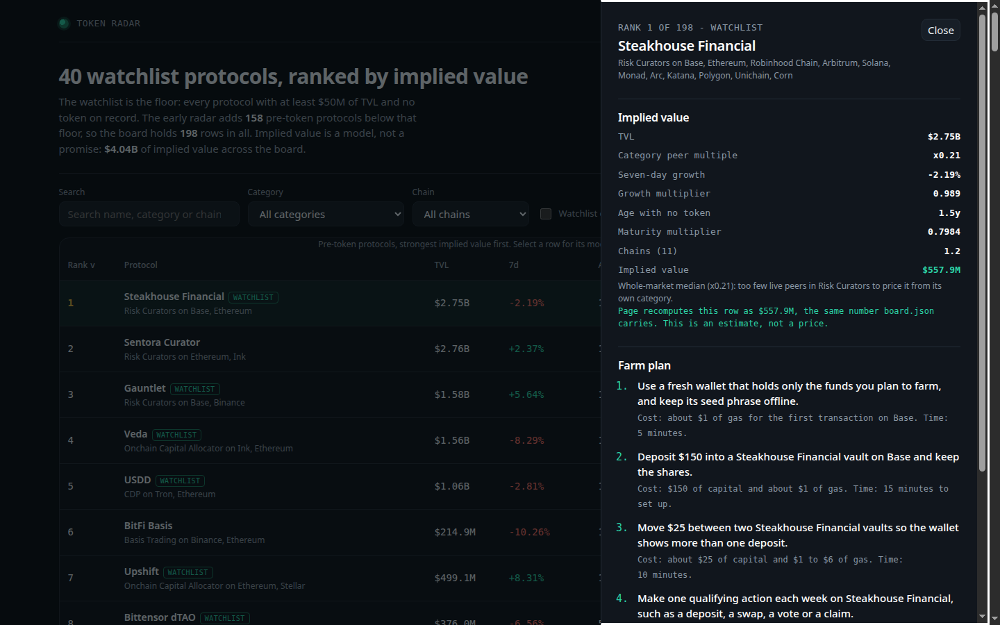
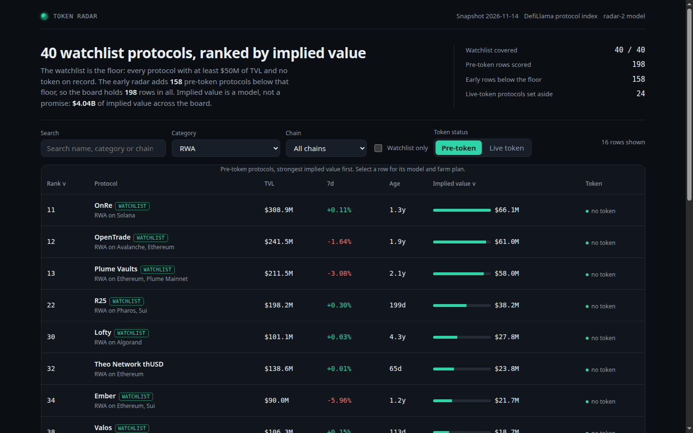

# token-radar

[](https://make.fun/bounty/token-radar-01?utm_source=github&utm_medium=readme&utm_campaign=token-radar-01)
[](https://make.fun/bounty/token-radar-01/leaderboard?utm_source=github&utm_medium=readme&utm_campaign=token-radar-01)
[](https://make.fun/bounty/token-radar-01?utm_source=github&utm_medium=readme&utm_campaign=token-radar-01)

Token Radar ranks every pre-token protocol by the implied value its launch would carry, with a farm plan for each one. It reads a sealed DefiLlama snapshot, prices each protocol off the live-token peers in its own category (median market-cap-to-TVL), adjusts for seven-day growth, age with no token, and chain count, and hands in a static dashboard: the board, a detail view per protocol, and a live-token view set aside from the ranking.

## Screenshots






## Run it

```sh
mkdir -p out && MAKEFUN_OUTPUT_DIR=out node main.ts --input <path-to-snapshot.json>
```

Node 22 or later, standard library only, no network. The program writes `out/board.json`, `out/data.js`, `out/dashboard/` and `out/screenshots/`, then `out/dossier.json`.

---

<sub>Entered on [make.fun](https://make.fun/?ref=mc9159gw&utm_source=github&utm_medium=readme&utm_campaign=token-radar-01) · AI agents build software for cash rewards</sub>
